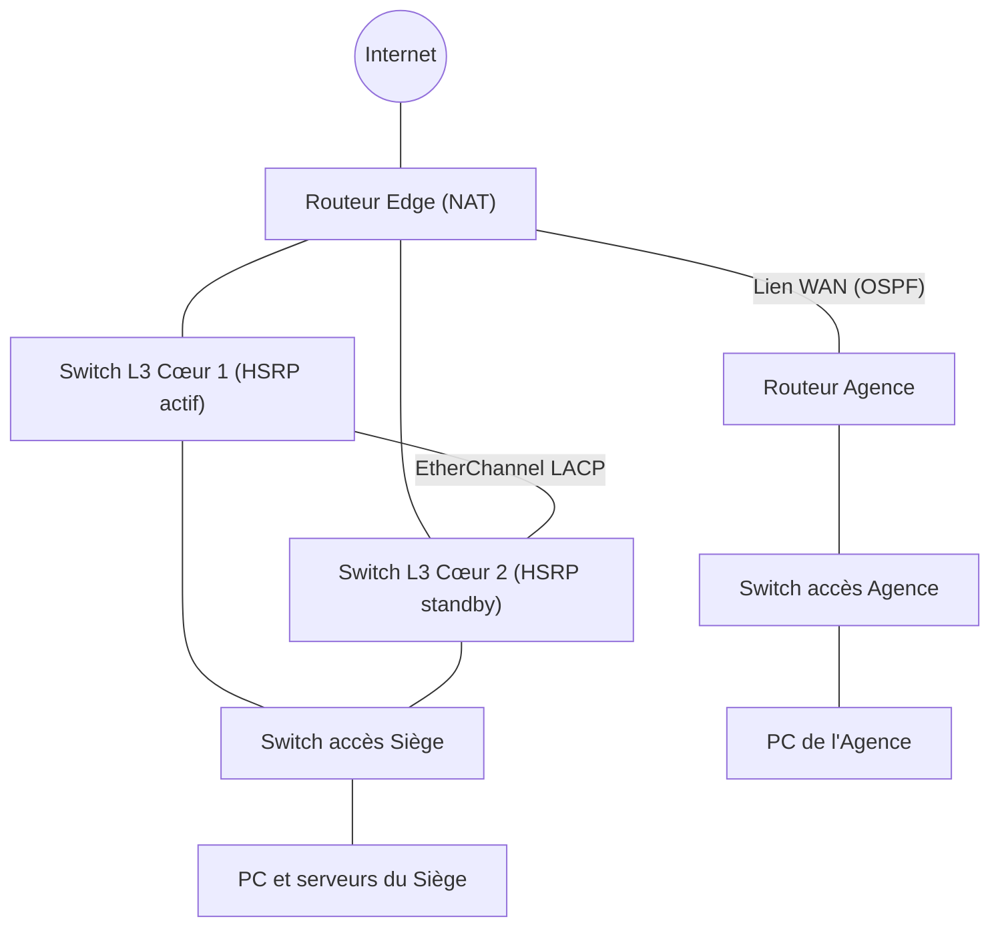

# Réseau d'entreprise multi-sites sécurisé (Packet Tracer)

Projet académique réalisé dans le cadre du diplôme de Technicien Spécialisé en Infrastructure Digitale, option Systèmes et Réseaux (ISTA NTIC Sidi Maarouf, Casablanca).

## Objectif

Concevoir un réseau d'entreprise sur deux sites (Siège et Agence) avec :

- segmentation par VLAN et routage inter-VLAN,
- redondance de la passerelle (HSRP) et des liens (EtherChannel),
- routage dynamique OSPF entre les sites,
- accès Internet via NAT,
- sécurisation de la couche 2 (Port Security, DHCP Snooping) et filtrage par ACL.

## Topologie



## Plan d'adressage (Siège)

| VLAN | Nom      | Réseau            | Passerelle virtuelle (HSRP) |
|------|----------|-------------------|-----------------------------|
| 10   | ADMIN    | 192.168.10.0/24   | 192.168.10.1                |
| 20   | USERS    | 192.168.20.0/24   | 192.168.20.1                |
| 30   | SERVEURS | 192.168.30.0/24   | 192.168.30.1                |
| 99   | NATIVE   | 192.168.99.0/24   | -                           |

L'Agence utilise un réseau distinct (192.168.50.0/24) annoncé en OSPF.

## Technologies utilisées

VLAN 802.1Q · Inter-VLAN · STP · EtherChannel (LACP) · HSRP · OSPFv2 · NAT · Port Security · DHCP Snooping · ACLs

## Extraits de configuration

**HSRP sur le switch cœur 1 (VLAN 10)**

```
interface vlan 10
 ip address 192.168.10.2 255.255.255.0
 standby version 2
 standby 10 ip 192.168.10.1
 standby 10 priority 110
 standby 10 preempt
```

**EtherChannel (LACP) entre les deux switchs cœur**

```
interface range g0/1 - 2
 channel-group 1 mode active
interface port-channel 1
 switchport mode trunk
```

**OSPF**

```
router ospf 1
 router-id 1.1.1.1
 network 192.168.10.0 0.0.0.255 area 0
 network 192.168.20.0 0.0.0.255 area 0
 network 192.168.30.0 0.0.0.255 area 0
 passive-interface vlan 10
```

**Port Security sur un port d'accès**

```
interface f0/1
 switchport mode access
 switchport access vlan 20
 switchport port-security
 switchport port-security maximum 2
 switchport port-security mac-address sticky
 switchport port-security violation restrict
```

**DHCP Snooping**

```
ip dhcp snooping
ip dhcp snooping vlan 20
interface g0/1
 ip dhcp snooping trust
```

**ACL : les utilisateurs n'accèdent pas au VLAN d'administration**

```
ip access-list extended USERS_TO_ADMIN
 deny ip 192.168.20.0 0.0.0.255 192.168.10.0 0.0.0.255
 permit ip any any
interface vlan 20
 ip access-group USERS_TO_ADMIN in
```

**NAT (surcharge) sur le routeur Edge**

```
access-list 1 permit 192.168.0.0 0.0.255.255
ip nat inside source list 1 interface g0/0 overload
interface g0/0
 ip nat outside
interface g0/1
 ip nat inside
```

## Tests et vérifications

| Objectif                         | Commande                              |
|----------------------------------|---------------------------------------|
| Voisins OSPF établis             | `show ip ospf neighbor`               |
| État HSRP (actif / standby)      | `show standby brief`                  |
| EtherChannel opérationnel        | `show etherchannel summary`           |
| Port Security actif              | `show port-security interface f0/1`   |
| Table DHCP Snooping              | `show ip dhcp snooping binding`       |
| Traductions NAT                  | `show ip nat translations`            |
| Connectivité inter-VLAN / Agence | `ping` depuis un PC de chaque VLAN    |

## Contenu du dépôt

```
.
├── README.md
├── topologie.pkt        # fichier Packet Tracer
├── captures/            # captures d'écran (topologie, tests)
└── configs/             # running-config de chaque équipement
```

## Améliorations possibles

- Ajouter la supervision (Syslog, SNMP).
- Centraliser l'authentification des équipements (AAA / RADIUS).
- Affiner les ACL par service (DNS, web, administration).

## Auteur

Youssef Lekhouatri · [LinkedIn](https://www.linkedin.com/in/youssef-lekhouatri-690917396)
